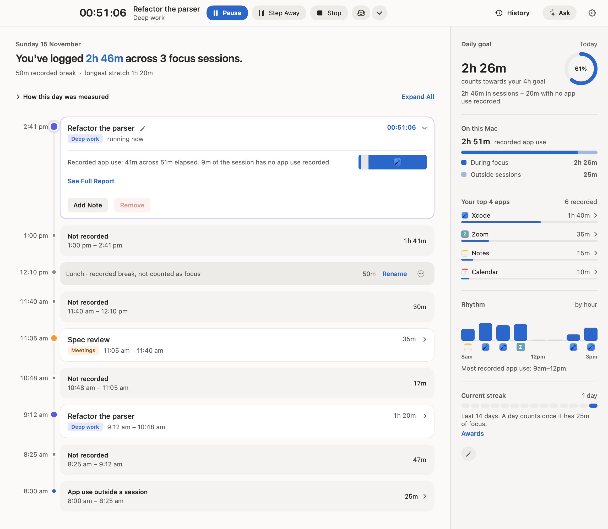
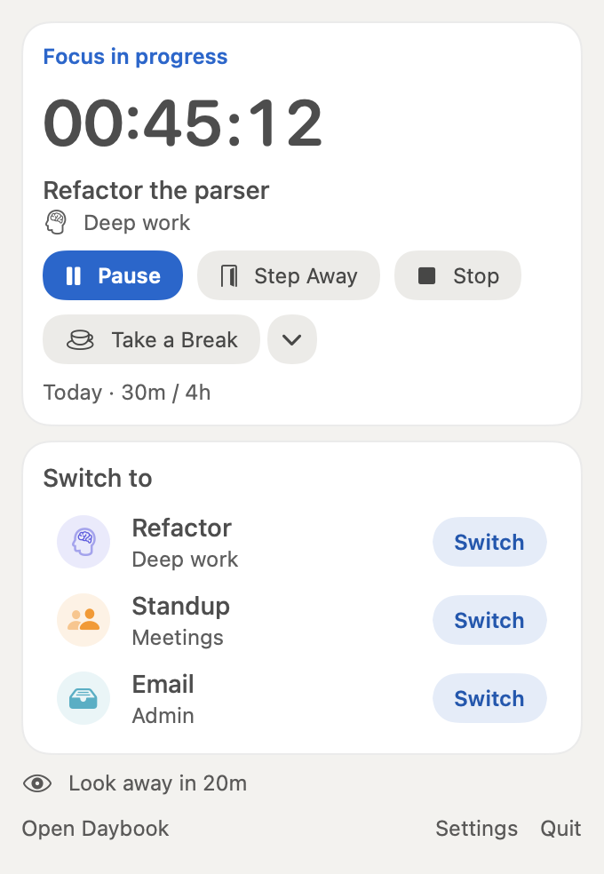
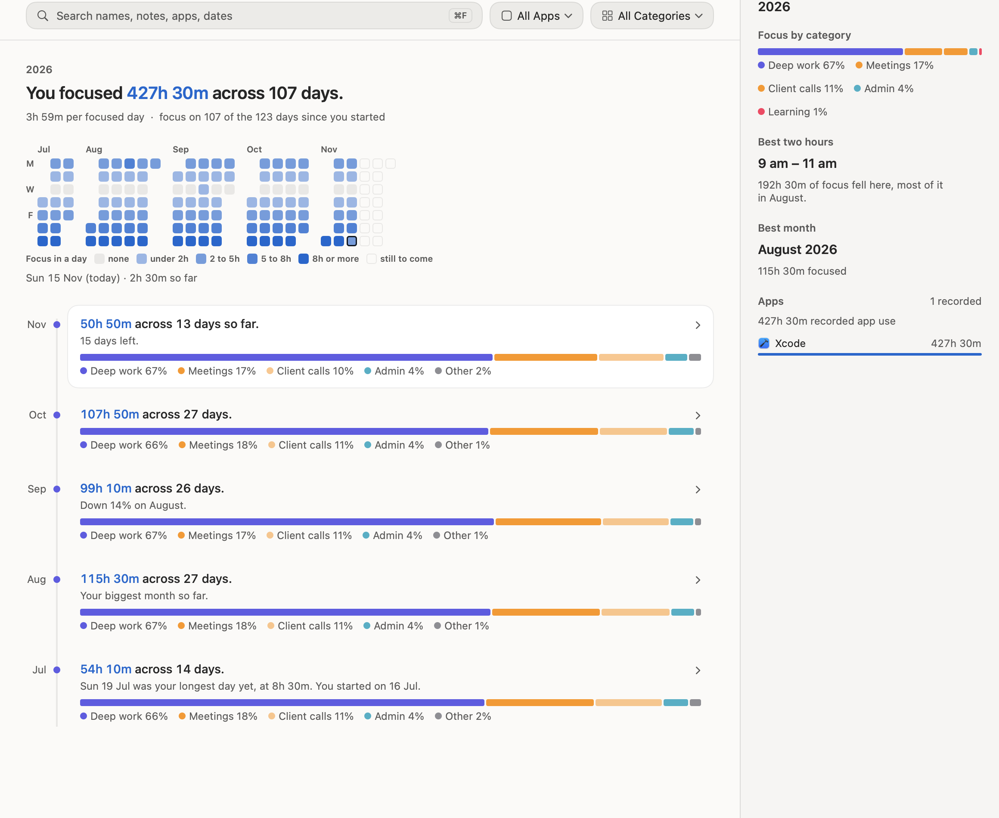
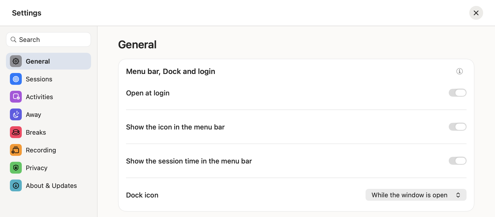
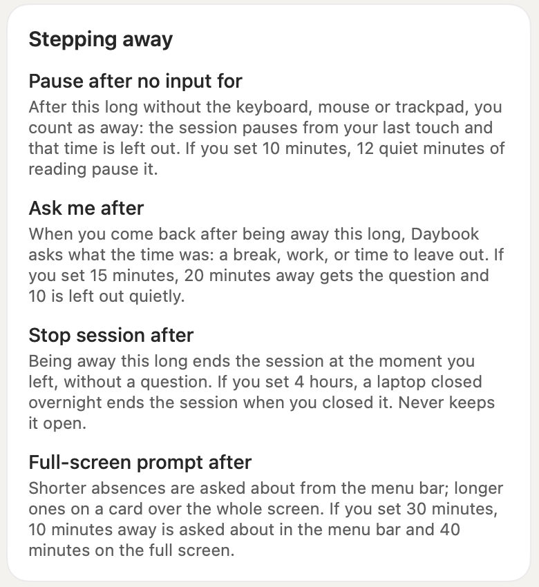
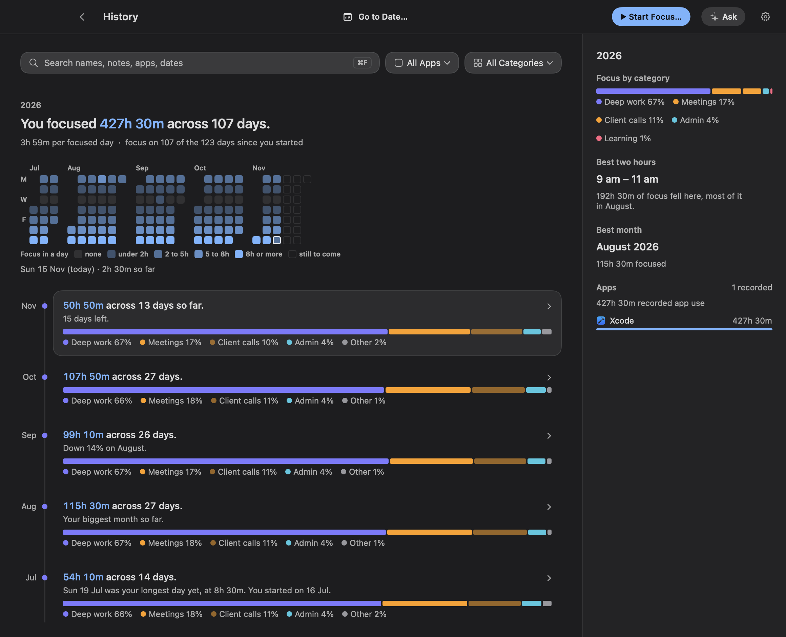

# Daybook

Daybook is a small Mac app that lives in your menu bar and keeps an honest
record of your working day. You start a focus session (or let Daybook start
one for you), work as usual, and Daybook counts only the time it has evidence
for. When you step away, it pauses and asks what that time was instead of
guessing. At the end of the day it tells the day back to you as a story: what
you worked on, for how long, where the breaks were, and what it could not
measure.

It is for one person on one Mac: developers, writers, designers, students,
freelancers and anyone who wants to know where their hours really went,
without a timer to babysit, an account to create or a company server holding
their history.



**[Download Daybook](https://github.com/prabeshbhetwal/Daybook/releases/latest/download/Daybook.dmg)**
for macOS 14 or later. Free and open source under the MIT licence. Your record
stays on your Mac.

## The everyday problems it solves

Most people who try to track their time run into the same handful of
problems. Daybook was built around them.

| The problem | What usually happens | What Daybook does |
|---|---|---|
| **The forgotten timer** | You start a timer, get pulled into a call or lunch, and it runs for an hour nobody worked. Or you forget to start it at all. | After a quiet spell with no keyboard, mouse or trackpad, the session pauses from your last touch. Daybook can also start a session for you once you have been in your work apps for a few minutes. |
| **Inflated hours** | The total says eight hours, but you know a good part of that was email, video or an open window you were not looking at. | Time in a session counts towards your goal only while you are actually using the Mac. Session time the Mac could not confirm is shown on its own line, never quietly added in. |
| **Stepping away** | A coffee, a chat with a colleague, a school pickup: the tracker either counts it as work or throws the whole session away. | A short absence is left out without a question. After a longer one, Daybook asks when you come back: a break, work, away, or a fresh start. Nothing is counted as focus unless you say it was work. |
| **Context switching** | A "coding" hour that was really half chat and half browsing reads the same as an hour of deep work. | Each session shows what its time was spent on, phase by phase, and how deep the work was. A session that held two pieces of work can be split in two, and merged back. |
| **No honest record of the day** | By evening you cannot say where the day went, and a spreadsheet of app names does not help. | Today reads as a story, in order, with breaks and gaps in their places. History keeps every day, week, month and year, and you can search it or ask it questions in plain words. |
| **Trackers that watch too much** | Many trackers upload everything you do to a server, read window titles or take screenshots. | There is no account and no server. Daybook notes which app is in front and for how long, never what is in it. Its AI features run on your Mac and send nothing away. |

## How it works, in plain words

1. **The Mac notices which app is in front, and whether you are using it.**
   Daybook reads the app's name and whether keys, clicks and scrolls are
   happening. It never reads what you type, what is on the screen or what is
   inside the app.
2. **A session is a stretch of work you declare.** You start one with a name
   and a category, such as Deep work or Meetings. If you prefer, Daybook starts
   one by itself when you settle into your work apps, says why it did, and
   offers Undo.
3. **Every half minute becomes evidence.** Daybook sorts each app into a kind
   of activity (Coding, Writing & AI, Design, Communication, Research, Media or
   Utility) and turns a session into phases: what you were doing, in order, and
   whether the work was Deep, Light or Passive. A browser you are typing and
   clicking in counts as Research; a browser you are only watching counts as
   Media.
4. **Quiet time is a question, not a guess.** When you go quiet, the session
   pauses from your last touch. When you return, Daybook asks how to count the
   gap. If an app was working for you while you watched, such as an AI agent, a
   render or a build, Daybook can count that as work.
5. **The figures stay honest.** What you declared and what the Mac observed
   are kept apart and named on screen. Where nothing was recorded, the story
   says so. Older records are never quietly rewritten.

### How it compares

Time trackers for one person's work mostly come in three kinds. Each makes a
trade, and Daybook makes a different one.

| Kind of app | What that approach gives up | What Daybook does instead |
|---|---|---|
| A manual start and stop timer | It counts everything between start and stop. A lunch with the timer left running becomes an hour of work unless you remember to fix it. | You still start sessions yourself, but after a quiet spell with no keyboard, mouse or trackpad, the session pauses from your last touch. A short absence is left out; after a longer one, Daybook asks when you come back whether it was a break, work, or time to leave out. |
| An automatic tracker that logs every app | It records everything and leaves the sorting to you, and an app being in front is taken as you working in it. | Daybook records app use too, but keeps it apart from the sessions you declare and never adds the two together. A session's figures come from what was recorded, and the day reads as a story, not a table. |
| A cloud time tracker built for teams and billing | Your record lives in an account on someone else's servers, organised around projects, clients and invoices. | There is no account and no server. The record is kept on your Mac, and on-device AI answers questions about it without sending anything away. Daybook is for one person on one Mac: it has no team, invoicing or sync features. |

Behind those choices is one rule: evidence comes before interpretation.

- **Declared and observed time stay separate.** A focus session is something
  you start. App use is something the Mac saw. Each is named on screen, and
  neither is passed off as the other.
- **Time away is asked about or left out, never counted silently.** A short
  absence is left out without a question, a longer one is asked about when you
  come back, and one past the limit you set ends the session at the moment you
  left. None of it counts as focus unless you say it was work.
- **Daybook says what it could not measure.** Where nothing was recorded, the
  story says so. Session time the Mac could not confirm is shown on its own
  line, and older records from before a recording fix are marked as less
  certain rather than quietly rewritten.
- **Corrections are yours and can be undone.** Renaming a session, changing
  its category or re-answering an away question never moves its times, and
  Undo puts back only what you changed.

## What it does, by the problem it solves

### Never babysit a timer

- Start a focus session from the bar at the top of the window, from the menu
  bar, or from any app with Control-Option-Space (record your own keys in
  Settings). Give it a name and a category, or make categories of your own
  with their own icons, colours and daily goals.
- Pause keeps recording app use; Step Away records nothing until you are back;
  Stop ends the session. A session you stopped can be continued later as the
  same thread, even on another day.
- Unless you turn it off, Daybook starts a session by itself after about 5
  minutes in work apps such as a code editor, and pauses it when you move to a
  break app such as a video player.
- Activity rules, which you turn on in Settings, let you say which apps belong
  to which activity, such as Coding, and how long to wait before a session
  starts (30 seconds to 30 minutes). While rules are on, they replace the
  guessing. A rule starts a session only when none is running, and an app
  shared by two rules asks which one you mean rather than starting both.
- Every automatic start says why it happened and offers Undo. A session you
  started and named yourself is never relabelled.
- The menu bar panel shows the running session and its controls, up to three
  recent activities to switch to, and break status, without opening the
  window.



### Step away without spoiling the record


- After a quiet spell you choose, the session pauses from your last touch. Come
  back after a longer spell and Daybook asks what the time was: a break, work,
  away, or a fresh start. Short absences are asked about from the menu bar,
  long ones on a card over the screen.
- While an answer is waiting, every other session action leads back to it, so
  nothing is counted by accident.
- If an app is working for you while you watch, such as an AI agent, a render
  or a build, Daybook can count that as work. It notices from how much an app
  you used this session is sending or computing, or an agent can tell it
  directly. It never reads what the app holds.
- Every sleep, wake, lock and restart of the Mac is recorded as it happens,
  so the story can say why each hole in a day is there.

### Hours you can trust

Daybook keeps these measures apart and names each one on screen:

| Measure | What it means |
|---|---|
| Focused | Time in your focus sessions, clipped to the day or period shown |
| Focused and active | Focus that overlaps hands-on app use; the only time that counts towards your goal |
| Recorded app use | What the Mac saw in front; never presented as deliberate work |
| Focus the Mac could not confirm | Session time without app-use records; shown, never added to app use |
| Break and away | Rest or absence you declared; never counted as focus |

- A session that crosses midnight gives each day only its share. The day's
  total of logged focus can be more than its recorded app use, and the story
  explains why rather than hiding the difference.
- A category can be set not to count towards focus goals, for time you want
  recorded but not credited, such as admin or reading. Its time stays in the
  story but is left out of focus totals and streaks, and a daily goal on it is
  paused rather than missed.

### See where your attention went

- Each session shows its phases: a strip of what the time was spent on,
  in order, with focused work drawn solid, other counted time drawn quieter
  and uncounted time (a pause, time away) drawn as an outline, plus a word for
  how deep the work was.
- Each session also records how it began: whether you started it, one of
  your Activity Rules did or Daybook did, and where its category came from.
  When the activity contradicts the label, the report says so in one line.
- A session that held two pieces of work can be split in two and merged back,
  without changing your totals. Daybook offers the split when it sees one, and
  an automatic session splits itself, with Merge back.

### A record of the day you can actually read

- Today is told as a story: current work at the top, earlier work and rest
  below, with breaks, gaps and app use in their places. Open any entry to see
  its apps, the shape of the work over time, notes and power use, and a full
  report. Expand All opens every entry at once, including the card that says
  what the Mac did (sleep, wake, lock and restart) during the day.
- Beside the story, the rail shows today's goals, the day's app use, its
  rhythm and your streak.
- Add notes to a session by typing or dictating.



- History opens on a headline for your whole record, a calendar with one cell
  per day shaded by how much you focused, and then your months (or weeks, or
  years) on a timeline, newest first. The period you are in is drawn as a card;
  each one says its focus and focused days in a sentence, with a thin bar of
  its categories.
- Click a period to open it, step by step: years into months, months into
  weeks, weeks into days, days into sessions, back to your first recorded day
  and no further. The rail beside it describes whatever is open: category
  shares, best two hours, goal rates, apps, the best month or day, a day's
  notes, or a session's stretches and its full note.
- Search sessions by name, note, app, category or date with Command-F, and
  Go to Date opens a calendar that shows each day's focus.
- History states only what the record supports. The current month's pace,
  quality and continuity, and comparisons between months, appear only when
  there is enough recorded to say them.


### Goals that keep you going, honestly

- Set a daily focus goal, and add up to eight more on Today's goals: a target
  for a category such as Coding, or a limit to stay under for an app or for a
  kind of activity such as Media or Communication. An app limit counts all the
  time that app was in front that day, in a session or not.
- A streak counts the days in a row that reach the minimum you set.
- Awards mark milestones from what was recorded, with their rules shown. A
  day when every goal is kept is a Perfect day, and an award a goal earned
  stays after the goal is paused or removed.
- A closed day is judged by its own goals, and only when something was
  recorded.

### Filing without the effort

- Daybook remembers how you file a kind of session and suggests the same
  category next time.
- On a Mac with on-device AI, an automatic session whose apps do not settle
  its category can be given to the on-device model once, which suggests one of
  your categories. By default the answer is only a suggestion in the session
  report. Turn on "Let AI assign categories to automatic sessions" and Daybook
  files the session itself, marked with a small sparkle, where you can keep or
  change it. Settings shows how often the AI matched your own choices.

### Ask your history, on your Mac

- On macOS 26 or later, on a Mac that supports on-device AI, press Command-K
  and ask about your history in plain words: focus totals, your best days,
  weeks and months, sessions and their stretches, breaks, time away and what
  the Mac did in between, notes, categories, app hours, the daily goal and
  awards.
- Every answer lists where it came from, and each source opens that place in
  the app.
- The same on-device AI writes short review notes about your days (Yesterday,
  and Wrap up today), suggests names for unnamed sessions, and helps History's
  search understand unusual questions. Nothing is sent anywhere to do it, and
  Settings can turn it off.

### Breaks that fit how you work

- Reminders timed from your typing and clicking, in a rhythm you pick: Steady,
  Pomodoro, Deep work, Flow or your own numbers.
- A plan for each weekday, with overrides for today, this week, this month or
  a range of dates, and working hours outside which reminders stay quiet.
- A short eye-rest reminder every 20 minutes, one firmer reminder after a long
  stretch without a break, a sound when a break is over, and the break
  countdown in the menu bar.
- Name a break and it reads by that name in the story. A break counts as rest,
  not focus, unless you choose Count as Focus on it.

### Settings that explain themselves



- Every Settings panel has a small circled "i" in its corner. Click it, or
  press Space or Return on it, and a card names each control in that panel and
  says what it changes, in plain words, with an example.
- Settings has seven pages (General, Sessions, Activities, Away, Breaks,
  Privacy & Data, and About & Updates) and a search that finds any control.
  Each setting sits on the page named for what it changes: how Daybook looks
  and sounds is General, how a session starts, ends and counts is Sessions,
  and what Daybook records, reads, keeps and backs up is Privacy & Data.



### Backups

- Backups are off until you choose them. Today's story offers them once, and
  Settings can turn them on at any time.
- Back up every 6 hours, day or week to iCloud Drive or a folder you choose,
  such as another disk. Keep automatic backups forever or for a period you set;
  a backup you make with Back Up Now is always kept.
- Settings shows the last and next backup, whether it has finished uploading
  to iCloud, and why an attempt failed if one did.

### Comfortable to use

- Full keyboard operation, VoiceOver labels, light and dark appearance, and a
  zoom for the whole interface from 80% to 160%.
- A seven-chapter welcome tour that can be skipped or replayed.



## Privacy

In short:

| | |
|---|---|
| **Stays on your Mac** | Your sessions, notes, app use, goals, categories and everything else you write. There is no account and no analytics. |
| **What Daybook looks at** | Which app is in front, for how long, and how many keys, clicks and scrolls happen, never which ones. To notice an app working for you, how much each app you used is sending or computing. Never what you type, what is on screen, window titles or page content. |
| **What the on-device AI sees** | For Ask, review notes and name suggestions: your own history, on the Mac. For a category suggestion: only minutes per kind of activity, how deep the work was, up to two app names, the kind of site if the site signal is on, and your category names. Nothing is sent anywhere. |
| **What can leave the Mac** | The update check (your version number, to GitHub), dictation where your language needs Apple's servers, and backups to your own iCloud Drive if you choose it. |
| **Special permissions** | None, unless you turn on the optional site signal, which is off by default. |

The details:

- **Your record stays on your Mac.** Daybook tracks which app is in front and
  for how long, never what is in it, with the one exception described under the
  site signal below. Session names, notes and everything else
  you write are kept on the Mac. There is no account and no analytics.
- **Each session records how it began.** Alongside its times, a session keeps
  whether you started it, one of your Activity Rules did (with the rule's
  name) or Daybook did, where its category came from (you, a rule, a choice
  you made before, the on-device AI, or Daybook's own default) and whether
  Daybook chose its name. It lives in the session's record on the Mac, so
  backups carry it.
  Splitting a session in two, or merging the halves back, never changes the
  time you worked: the halves add up to the original. A half you file under
  another category takes its time to that category. A session Daybook starts
  itself, or the second half of one it splits, that it cannot place under one
  of your categories is filed as Unsorted, which never counts toward your
  goals.
- **Leisure is kept apart.** With automatic sessions on, watching or listening
  for 10 minutes or more outside a session is kept in `leisure.json` beside
  your sessions: the app and the start and end times, nothing else. It shows
  on the day's timeline and never counts as focus or as a break. Backups
  include the file.
- **A small file remembers how you file things.** When you file a finished
  session under a different category, Daybook keeps `corrections.json` beside
  your sessions. It holds only a pattern fingerprint of that kind of session
  (the share of its time spent on each kind of activity, in steps of 20%, and
  the two apps with the most time, by bundle identifier), category names, a
  count and a date. It holds no session name, note, window title or page. It is
  used only to suggest a category: for a session whose category Daybook chose,
  and for the second half of a split. Daybook files that second half itself
  only when it started the session and split it. A session you or a rule filed
  is never offered another category. A choice you have not made again for 90
  days stops being suggested, and is dropped the next time the file is saved.
  Backups include the file.
- **What can leave the Mac**, and only these:
  - The update check asks GitHub for the latest version. It sends the version
    number you have. You can turn it off in Settings.
  - Dictating a note uses Apple's speech recognition, which runs on the Mac
    where your language supports that and otherwise may send the audio to
    Apple.
  - Backups, if you turn them on and choose iCloud Drive, are uploaded to your
    own iCloud account.
- **On-device AI stays on the device.** Ask, review notes, name suggestions and
  History's search run on the Mac, and your questions, history and answers are
  not sent anywhere.
- **On-device AI can suggest a category, and sees little.** When an automatic
  session of 10 minutes or more ends with the category Daybook chose for it, and
  the apps used do not settle which category fits, Daybook asks the on-device
  model once. It is told only the whole minutes spent on each kind of activity,
  how deep the work was, the names of up to two apps, the kind of site when the
  site signal is on, and a numbered list of up to 20 of your category names. It
  is never told the session's name or note, window titles, addresses or bundle
  identifiers. Each question runs on the Mac in a fresh session, so nothing
  carries over from one question to the next. While "Let AI assign categories to
  automatic sessions" is off, Daybook still asks whenever on-device AI is on,
  and shows the answer only as a suggestion in the session report. With the
  switch on, when the AI picks a category, Daybook files the session under it
  and marks it with a small sparkle on the session's row and in its report,
  where you can keep or change it. The AI makes at most one new label in any 24
  hours, and Remove on a label it made files every session carrying it as
  Unsorted. Daybook keeps `ai-labels.json` beside your sessions. It holds the
  labels the AI proposed and when each was made, the pattern fingerprints they
  stand for (the same kind `corrections.json` keeps, with the kind of site), the
  answer given for each kind of session, names you removed so they are not
  proposed again, and the last 50 comparisons of an answer with your own choice.
  It holds no session name, note, window title or address. Backups include the
  file.
- **No special access unless you turn on the site signal.** Daybook asks for no
  Accessibility, Automation, Screen Recording or Input Monitoring permission;
  it tells when you are away from system counters, not from what you type. The
  one exception is the site signal in Settings › Privacy & Data, off by default. If
  you turn it on, Daybook asks for Accessibility to read the address of the
  front tab in the browsers you choose, keeps only what kind of site it is
  (video, documentation, social and so on) and discards the address
  immediately. It never reads page titles or page content and never queries any
  other app. Sites it knows as banking, health, government, sign-in or adult
  give no signal and are never kept. Site names are kept only if you turn on
  Remember sites, and only the ones you add. Turning the signal off stops
  reads at once, and no site kind is noted after the half-minute you are in.
  The switch stays unavailable on a version of macOS until the signal
  has been tested there. The prompts you may see are for notifications (at
  first launch, for break reminders) and for the microphone and speech
  recognition (only when you dictate a note). Open at login, if you turn it
  on, adds a login item.

## Install and update

1. Download [Daybook.dmg](https://github.com/prabeshbhetwal/Daybook/releases/latest/download/Daybook.dmg),
   open it and drag Daybook onto Applications.
2. Daybook is not notarised, so the first time you open it macOS says it cannot
   check it for malware. Click Done, then in System Settings, Privacy &
   Security, find the message about Daybook and click Open Anyway. On macOS 14,
   Control-click Daybook in Applications and choose Open instead. macOS asks
   once.

After that, Daybook updates itself. It looks for a new version once a week and
offers it; Settings, About & Updates can check now, change how often, or
install updates without asking. It installs only updates signed with this
project's key. Every version is listed on the
[Releases page](https://github.com/prabeshbhetwal/Daybook/releases).

## Requirements

- macOS 14 or later.
- Ask and the other on-device AI features need macOS 26 or later on a Mac that
  supports on-device AI. Everything else works without them.

## Your first five minutes

1. Open Daybook. Its icon appears in the menu bar, and a short welcome tour
   walks through the app; you can skip it and replay it later from Settings.
2. Type what you are about to work on in the bar at the top of the window,
   pick a category and choose Start. Control-Option-Space does the same from
   any app.
3. Work as usual. If you step away for a while, Daybook pauses the session
   and, when you come back, asks how that time should count.
4. Choose Stop when you finish, then read today's story. Click an entry to see
   its apps and how the time went.
5. Press Command-2 for History, and Command-comma for Settings, where each
   panel's "i" explains what its controls do. Turn on backups when the story
   offers them.

The full guide to every screen and control is in [docs/usage.md](docs/usage.md).

## Questions people ask

### Does Daybook read what I type or take screenshots?

No. It counts keys, clicks and scrolls to know you are there, never which
ones, and it never captures the screen or reads inside an app. The optional
site signal, off by default, keeps only the kind of site in a browser tab.

### What if I forget to stop a session?

When you go quiet, the session pauses from your last touch. Past the limit
you set in Settings › Away, it ends at the moment you left, not when you came
back.

### I was watching a long build or an AI agent. Does that count?

It can. Daybook notices when an app you used this session keeps sending or
computing, or an agent can tell it directly. Settings › Away chooses whether
that time counts as work, pauses without asking, or counts as time away.

### Do I need Apple Intelligence?

No. Ask, review notes, name suggestions and category suggestions need macOS
26 or later on a Mac that supports on-device AI. Everything else works on
macOS 14 or later without them.

### Can I fix a session that went wrong?

Yes. Rename it, change its category, split it in two or merge it back, and
re-answer an away question. None of these moves its times, and Undo puts back
only what you changed.

### Is it for teams or client billing?

No. Daybook is for one person on one Mac. It has no team, invoicing or sync
features.

### What does it cost?

Nothing. It is free and open source under the MIT licence.

### Will I lose my history if something goes wrong?

Daybook saves carefully: a failed save keeps the old record and offers Retry.
For a copy somewhere else, turn on backups to iCloud Drive or another disk.

---

# For developers

Daybook is written in Swift with SwiftUI, AppKit and Swift Charts. There is no
Xcode project: one build script compiles every file under `Sources/` with
`swiftc`. The only dependency is Sparkle, for updates. There is no telemetry.

## How it is verified

- **1951 headless checks** run from the app binary itself (`--selftest`). They
  use an injected clock, isolated preferences and temporary archives, so they
  cover session state transitions, cross-midnight clipping, wake and presence
  handling, persistence failures, accuracy epochs, corrections and Undo,
  accessibility targets, settings effects and where rendered controls and
  edges actually land, without touching real data.
- **Every push** runs the same checks on GitHub Actions on macOS 26, in UTC
  and again in Sydney and Berlin time ([`check.yml`](.github/workflows/check.yml)),
  so they hold on an older system than the one they are written on, and in
  other time zones.
- **A snapshot matrix** renders every surface in light, dark and system
  appearance through offscreen AppKit hosting, with real native controls, for
  visual review (`--snapshot`). The screenshots above come from it, drawn from
  fixtures rather than anyone's real history.
- **A fixture-only app** (`scripts/build-fixture-app.sh`) has its own bundle
  identifier and cannot open real data, so native UI automation can run safely.
  To check a start-to-History flow in a separate native app, run
  `scripts/build-fixture-app.sh focusSmoke`, then open the printed app path.
  Confirm the window title ends in "safe verification". On Focus, enter
  `Fixture smoke`, select a focus category, and choose **Start focus**. Wait at
  least 35 seconds, then choose **Stop**. Open **History**, search for
  `Fixture smoke`, and confirm the ended session appears with a positive
  duration. Quit the fixture app when finished. Its clock advances, but its
  archive is temporary and preferences are in memory; it does not load the
  live app's history. The bundle is ad-hoc signed for local verification only.
- **The build is strict**: Swift 5 mode with warnings as errors, a strict deep
  signature check, and tests run before the local app is replaced. If anything
  fails, including during the swap, the previous app is put back.

## Engineering notes

**Absence without guessing.** Locks, sleep and idle time end in a decision:
break, working, away or start fresh. While a decision is open, every other
session action routes back to it, including the global hotkey. Corrections
(rename, change type, re-answer an away) apply to the whole thread across days,
never move time boundaries, survive relaunch, and can be undone field by field.
Writes are atomic, a failed save keeps the old record and offers Retry, and an
interrupted write cannot record the same interval twice. Every sleep, wake,
lock, log out, restart, shut down and quit is recorded as it happens, and a
crash, force quit or power cut is worked out at the next launch, so History
names why each hole in a day is there.

**Data that ages honestly.** App-use history is a versioned envelope with an
accuracy epoch. Data recorded before a recorder fix is preserved and marked as
less certain wherever an exact claim would mislead; it is never silently
rewritten. Older formats are backed up byte for byte before migration.

**Cheap to leave running.** A menu bar app runs all day, so idle cost matters.
Profiling showed that SwiftUI windows keep re-rendering on every data update
even when closed, and the hidden menu bar panel alone was costing about 45 ms
of work each second. Closed windows and panels now rest until shown again, and
the app's CPU use during normal work went from 0.9% to 0.1%.

**Apps working for you.** Quiet while an app works for you can count as work:
noticed from what the session's apps send and compute, or told by an agent's
own hooks, rather than read from a screen kept awake. The details, including
the thresholds, are in [docs/usage.md](docs/usage.md#apps-working-for-you).

## How the work is organised

Features move through written documents before and after the code, and all of
them are in [`docs/`](docs):

1. **Spec**: the problem, the decisions and what is out of scope.
   Example: [honest session time](docs/specs/2026-08-17-honest-session-time-design.md).
2. **Plan**: small, testable steps with the checks each one must pass.
   Example: [complete Story interactions](docs/plans/2026-08-31-complete-story-interactions.md).
3. **Review**: an audit against the spec, then verification of every finding.
   Example: [design and behaviour audit](docs/reviews/2026-08-31-design-and-behaviour-audit.md)
   and its [remediation verification](docs/reviews/2026-08-31-story-remediation-verification.md).

[`PRODUCT.md`](PRODUCT.md) holds the product principles and
[`DESIGN.md`](DESIGN.md) the design system. Commit messages describe the change
they make, so `git log` reads as a changelog. The code is also kept lean on
purpose: a recent pass removed about 7,300 lines of views, members and build
machinery that nothing used any more, with no change in behaviour.

## Build and run

Requirements: macOS 14 or later and the Apple Command Line Tools (`swiftc`).
Xcode is not needed.

```bash
./build.sh          # Build and replace the local app after verification
./build.sh --run    # Build, verify and open Daybook.app
./build.sh --test   # Build, run the checks, then replace the local app
./build.sh --check  # Build and run the checks without replacing the app
./build.sh --install  # Like --test, but replaces /Applications/Daybook.app
```

Replacing the local app relaunches it if it was running from that folder, so
it never keeps running from files the swap deleted. For an app you keep using,
install the latest release's `Daybook.dmg` instead: it updates itself from
GitHub Releases. A local build is for testing, and iCloud's Desktop and
Documents quarantine a bundle built inside them, so macOS runs it from a
read-only copy that cannot update itself.

The binary is built with `-Osize` and stripped of local symbols. To profile
with `sample`, build once with `FC_KEEP_SYMBOLS=1 ./build.sh`.

The first build downloads Sparkle 2.10.0 into `.build/vendor` and checks it
against a pinned SHA-256.

The app is ad-hoc signed and not notarised. `scripts/release.sh <version>`
runs the checks, builds, signs the update and publishes it to
[GitHub Releases](https://github.com/prabeshbhetwal/Daybook/releases) with its
feed and `Daybook.dmg` for new installs; installed copies update through
Sparkle and accept only updates signed with the project's EdDSA key, which
stays in the Keychain.

Builds that replace the local app take a lock at `.build/promotion.lock`, so a
second build waits its turn. If a build is killed outright, remove that
directory once no build is running.

The binary also has review modes (`--gallery`, `--snapshot`,
`--fixture-window`, `--onboarding`), described in
[docs/usage.md](docs/usage.md#review-modes).

## Architecture

```text
Core                     App                            Design / Surfaces
──────────────────      ───────────────────────────    ──────────────────────────
SessionEngine            AppCoordinator                 MainWindowView / native sheets
AppUsageTracker          SessionStore (+ read models)   Story columns / rail / calendar
AppUsageArchive          SettingsModel                  History / Insights / Awards
DailyGoal                MainWindowModel                Focus / Settings / Popover
PeriodStats              Persistence wiring             Tokens / StoryStyle / controls
PresenceGate             Day and History projections    Away / Reward
StoryChronology
DateFormats
```

- **Core** is UI-free: the session state machine, usage tracking, clipping,
  goals, periods, persistence formats and pure calculations.
- **App** owns macOS event wiring and publishes read models. It is the only
  boundary for session actions, settings, refresh coalescing and navigation.
- **Design / Surfaces** renders those models. Views never read storage or
  recalculate time.

One one-second ticker, in `SessionStore`, drives presence checks, usage
checkpoints, live figures and break evaluation. The UI adds no timers of its
own.

Data lives in `~/Library/Application Support/Daybook/`: `sessions.json` for
sessions, and for app use a snapshot, `app-usage.json` (a versioned v2
envelope), plus `app-usage-journal.jsonl`, the changes since that snapshot.
`sessions.json` and the snapshot are replaced atomically. Each change to app
use is one line appended to the journal, and the snapshot is rewritten only
when the journal grows long, so the history is never trimmed. If a crash cuts
the last line short, the next launch drops that one change and keeps
everything before it.

Notes and power readings for each session follow the same pattern:
`session-metadata.json` (version 2) plus `session-metadata-journal.jsonl`.
A power reading is one journal line rather than a rewrite of every session's
metadata. A version 1 file is rewritten as version 2 before the first journal
line, so a build that does not know the journal leaves it read-only rather than
writing over changes it cannot see.

While app use is recorded, Daybook also keeps a `beats` folder holding, for
each app and half-minute, the seconds spent in the app, counts of keys, clicks
and scrolls, a presence state and which apps held the screen awake (never what
was typed) and, with the site signal on, the kind of site in the front browser
tab (never its address). The folder keeps 90 days and is left out of Daybook's own backups.
Each session also keeps a short summary of its phases in the notes files above
(`session-metadata.json` and its journal), not in its written note.

Until October 2026 the app was called FocusContinuity. Its first launch under
the new name carries the data folder and preferences across and deletes
nothing.

## Repository layout

```text
Sources/
  Core/                 Time accounting, persistence, periods and pure models
  App/                  macOS coordination, SessionStore and settings/navigation
  Design/               Semantic tokens and reusable SwiftUI components
  Surfaces/             Screens, popover, prompts, gallery and snapshots
  Verification/         Focused regression groups and isolated native-window mode
  SelfTest.swift        Headless check suite
build.sh                Build, signing, checks and local install
scripts/                Releases, the Sparkle fetch, the fixture app and probes
docs/                   Specs, plans, reviews, design references and screenshots
.github/workflows/      Every self-check on each push
```

## Contributing

Keep the Core → App → Design/Surfaces boundary intact. Add a focused headless
check before changing behaviour, preserve recorded evidence rather than
rewriting it, and run `./build.sh --check` before committing.

## License

MIT. See [LICENSE](LICENSE).
