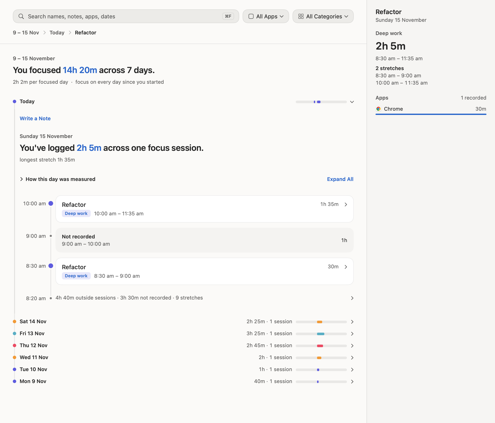
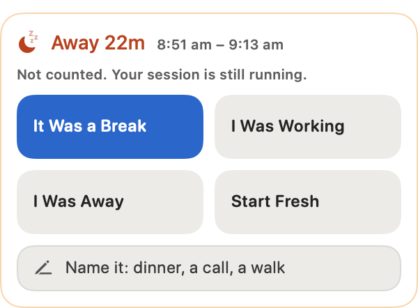

# Daybook

A Mac menu bar app that keeps your focus time honest: it counts what was
actually recorded, asks about the time you were away instead of guessing, and
tells each day back to you as a story.


**[Download Daybook](https://github.com/prabeshbhetwal/Daybook/releases/latest/download/Daybook.dmg)**
for macOS 14 or later. Free and open source under the MIT licence. Your record
stays on your Mac.

## Why Daybook is different

Time trackers for one person's work mostly come in three kinds. Each makes a
trade, and Daybook makes a different one.

| Kind of app | What that approach gives up | What Daybook does instead |
|---|---|---|
| A manual start and stop timer | It counts everything between start and stop. A lunch with the timer left running becomes an hour of work unless you remember to fix it. | You still start sessions yourself, but after a quiet spell with no keyboard, mouse or trackpad, the session pauses from your last touch. A short absence is left out; after a longer one, Daybook asks when you come back whether it was a break, work, or time to leave out. |
| An automatic tracker that logs every app | It records everything and leaves the sorting to you, and an app being in front is taken as you working in it. | Daybook records app use too, but keeps it apart from the sessions you declare and never adds the two together. A session's figures come from what was recorded, and the day reads as a story, not a table. |
| A cloud time tracker built for teams and billing | Your record lives in an account on someone else's servers, organised around projects, clients and invoices. | There is no account and no server. The record is kept on your Mac, and on-device AI answers questions about it without sending anything away. Daybook is for one person on one Mac: it has no team, invoicing or sync features. |

Behind those choices is one rule: evidence comes before interpretation.

- **Declared and observed time stay separate.** A focus session is something
  you start. App use is something the Mac saw. Each is named on screen, and
  neither is passed off as the other.
- **Time away is asked about or left out, never counted silently.** A short
  absence is left out without a question, a longer one is asked about when you
  come back, and one past the limit you set ends the session at the moment you
  left. None of it counts as focus unless you say it was work.
- **Daybook says what it could not measure.** Where nothing was recorded, the
  story says so. Session time the Mac could not confirm is shown on its own
  line, and older records from before a recording fix are marked as less
  certain rather than quietly rewritten.
- **Corrections are yours and can be undone.** Renaming a session, changing
  its category or re-answering an away question never moves its times, and
  Undo puts back only what you changed.

## What it does

### Sessions and the day's story

- Start a focus session from the bar at the top of the window, from the menu
  bar, or from any app with Control-Option-Space (record your own keys in
  Settings). Give it a name and a
  category, such as Deep work or Meetings, or make categories of your own with
  their own icons, colours and daily goals.
- Pause keeps recording app use; Step Away records nothing until you are back;
  Stop ends the session. A session you stopped can be continued later as the
  same thread, even on another day.
- Today is told as a story: current work at the top, earlier work and rest
  below, with breaks, gaps and app use in their places. Open any entry to see
  its apps, the shape of the work over time, notes and power use, and a full
  report. Expand All opens every entry at once, including the card that says
  what the Mac did (sleep, wake, lock and restart) during the day.
- Beside the story, the rail shows the daily goal, the day's app use, its
  rhythm and your streak.
- Add notes to a session by typing or dictating. Awards mark milestones from
  what was recorded, with their rules shown.

### History


- History opens on a headline for your whole record, a calendar with one cell
  per day shaded by how much you focused, and then your months (or weeks, or
  years) on a timeline, newest first. The period you are in is drawn as a card;
  each one says its focus and focused days in a sentence, with a thin bar of
  its categories.
- Click a period to open it, step by step: years into months, months into
  weeks, weeks into days, days into sessions, back to your first recorded day
  and no further. The rail beside it describes whatever is open: category
  shares, best two hours, goal rates, apps, the best month or day, a day's
  notes, or a session's stretches and its full note.
- Search sessions by name, note, app, category or date with Command-F, and
  Go to Date opens a calendar that shows each day's focus.
- History states only what the record supports. The current month's pace,
  quality and continuity, and comparisons between months, appear only when
  there is enough recorded to say them.



### Stepping away and honest time



- After a quiet spell you choose, the session pauses from your last touch. Come
  back after a longer spell and Daybook asks what the time was: a break, work,
  away, or a fresh start. Short absences are asked about from the menu bar,
  long ones on a card over the screen.
- While an answer is waiting, every other session action leads back to it, so
  nothing is counted by accident.
- If an app is working for you while you watch, such as an AI agent, a render
  or a build, Daybook can count that as work. It notices from how much an app
  you used this session is sending or computing, or an agent can tell it
  directly. It never reads what the app holds.
- Daybook keeps these measures apart and names each one on screen:

| Measure | What it means |
|---|---|
| Focused | Time in your focus sessions, clipped to the day or period shown |
| Focused and active | Focus that overlaps hands-on app use; the only time that counts towards your goal |
| Recorded app use | What the Mac saw in front; never presented as deliberate work |
| Focus the Mac could not confirm | Session time without app-use records; shown, never added to app use |
| Break and away | Rest or absence you declared; never counted as focus |

A session that crosses midnight gives each day only its share. The day's total
of logged focus can be more than its recorded app use, and the story explains
why rather than hiding the difference.

### Breaks

- Reminders timed from your typing and clicking, in a rhythm you pick: Steady,
  Pomodoro, Deep work, Flow or your own numbers.
- A plan for each weekday, with overrides for today, this week, this month or
  a range of dates, and working hours outside which reminders stay quiet.
- A short eye-rest reminder every 20 minutes, one firmer reminder after a long
  stretch without a break, a sound when a break is over, and the break
  countdown in the menu bar.
- Name a break and it reads by that name in the story. A break counts as rest,
  not focus, unless you choose Count as Focus on it.

### Automatic sessions and activity rules

- Unless you turn it off, Daybook starts a session by itself after about 5
  minutes in work apps such as a code editor, and pauses it when you move to a
  break app such as a video player.
- Activity rules, which you turn on in Settings, let you say which apps belong
  to which activity, such as Coding, and how long to wait before a session
  starts (30 seconds to 30 minutes). While rules are on, they replace the
  guessing. A rule starts a session only when none is running, and an app
  shared by two rules asks which one you mean rather than starting both.
- Every automatic start says why it happened and offers Undo. A session you
  started and named yourself is never relabelled.

### Ask and on-device AI

- On macOS 26 or later, on a Mac that supports on-device AI, press Command-K
  and ask about your history in plain words: focus totals, your best days,
  weeks and months, sessions and their stretches, breaks, time away and what
  the Mac did in between, notes, categories, app hours, the daily goal and
  awards.
- Every answer lists where it came from, and each source opens that place in
  the app.
- The same on-device AI writes short review notes about your days (Yesterday,
  and Wrap up today), suggests names for unnamed sessions, and helps History's
  search understand unusual questions. Nothing is sent anywhere to do it, and
  Settings can turn it off.

### Settings that explain themselves


- Every Settings panel has a small circled "i" in its corner. Click it, or
  press Space or Return on it, and a card names each control in that panel and
  says what it changes, in plain words, with an example.
- Settings has eight pages (General, Sessions, Activities, Away, Breaks,
  Recording, Privacy, and About & Updates) and a search that finds any
  control.


### Backups

- Backups are off until you choose them. Today's story offers them once, and
  Settings can turn them on at any time.
- Back up every 6 hours, day or week to iCloud Drive or a folder you choose,
  such as another disk. Keep automatic backups forever or for a period you set;
  a backup you make with Back Up Now is always kept.
- Settings shows the last and next backup, whether it has finished uploading
  to iCloud, and why an attempt failed if one did.

### Also

- A menu bar panel with the running session and its controls, up to three
  recent activities to switch to, and break status, without opening the window.
- Full keyboard operation, VoiceOver labels, light and dark appearance, and a
  zoom for the whole interface from 80% to 160%.
- A seven-chapter welcome tour that can be skipped or replayed.


## Privacy

- **Your record stays on your Mac.** Daybook tracks which app is in front and
  for how long, never what is in it, with the one exception described under the
  site signal below. Session names, notes and everything else
  you write are kept on the Mac. There is no account and no analytics.
- **Each session records how it began.** Alongside its times, a session keeps
  whether you started it, one of your Activity Rules did (with the rule's
  name) or Daybook did, where its category came from (you, a rule, a choice
  you made before, or Daybook's own default) and whether Daybook chose its
  name. It lives in the session's record on the Mac, so backups carry it.
  Splitting a session in two, or merging the halves back, never changes the
  time you worked: the halves add up to the original. A half you file under
  another category takes its time to that category.
- **A small file remembers how you file things.** When you file a finished
  session under a different category, Daybook keeps `corrections.json` beside
  your sessions. It holds only a pattern fingerprint of that kind of session
  (the share of its time spent on each kind of activity, in steps of 20%, and
  the two apps with the most time, by bundle identifier), category names, a
  count and a date. It holds no session name, note, window title or page. It is
  used only to suggest a category: for a session whose category Daybook chose,
  and for the second half of a split. Daybook files that second half itself
  only when it started the session and split it. A session you or a rule filed
  is never offered another category. A choice you have not made again for 90
  days stops being suggested, and is dropped the next time the file is saved.
  Backups include the file.
- **What can leave the Mac**, and only these:
  - The update check asks GitHub for the latest version. It sends the version
    number you have. You can turn it off in Settings.
  - Dictating a note uses Apple's speech recognition, which runs on the Mac
    where your language supports that and otherwise may send the audio to
    Apple.
  - Backups, if you turn them on and choose iCloud Drive, are uploaded to your
    own iCloud account.
- **On-device AI stays on the device.** Ask, review notes, name suggestions and
  History's search run on the Mac, and your questions, history and answers are
  not sent anywhere.
- **No special access unless you turn on the site signal.** Daybook asks for no
  Accessibility, Automation, Screen Recording or Input Monitoring permission;
  it tells when you are away from system counters, not from what you type. The
  one exception is the site signal in Settings › Privacy, off by default. If
  you turn it on, Daybook asks for Accessibility to read the address of the
  front tab in the browsers you choose, keeps only what kind of site it is
  (video, documentation, social and so on) and discards the address
  immediately. It never reads page titles or page content and never queries any
  other app. Sites it knows as banking, health, government, sign-in or adult
  give no signal and are never kept. Site names are kept only if you turn on
  Remember sites, and only the ones you add. Turning the signal off stops
  reads at once, and no site kind is noted after the half-minute you are in.
  The switch stays unavailable on a version of macOS until the signal
  has been tested there. The prompts you may see are for notifications (at
  first launch, for break reminders) and for the microphone and speech
  recognition (only when you dictate a note). Open at login, if you turn it
  on, adds a login item.

## Install and update

1. Download [Daybook.dmg](https://github.com/prabeshbhetwal/Daybook/releases/latest/download/Daybook.dmg),
   open it and drag Daybook onto Applications.
2. Daybook is not notarised, so the first time you open it macOS says it cannot
   check it for malware. Click Done, then in System Settings, Privacy &
   Security, find the message about Daybook and click Open Anyway. On macOS 14,
   Control-click Daybook in Applications and choose Open instead. macOS asks
   once.

After that, Daybook updates itself. It looks for a new version once a week and
offers it; Settings, About & Updates can check now, change how often, or
install updates without asking. It installs only updates signed with this
project's key. Every version is listed on the
[Releases page](https://github.com/prabeshbhetwal/Daybook/releases).

## Requirements

- macOS 14 or later.
- Ask and the other on-device AI features need macOS 26 or later on a Mac that
  supports on-device AI. Everything else works without them.

## Your first five minutes

1. Open Daybook. Its icon appears in the menu bar, and a short welcome tour
   walks through the app; you can skip it and replay it later from Settings.
2. Type what you are about to work on in the bar at the top of the window,
   pick a category and choose Start. Control-Option-Space does the same from
   any app.
3. Work as usual. If you step away for a while, Daybook pauses the session
   and, when you come back, asks how that time should count.
4. Choose Stop when you finish, then read today's story. Click an entry to see
   its apps and how the time went.
5. Press Command-2 for History, and Command-comma for Settings, where each
   panel's "i" explains what its controls do. Turn on backups when the story
   offers them.

The full guide to every screen and control is in [docs/usage.md](docs/usage.md).

---

# For developers

Daybook is written in Swift with SwiftUI, AppKit and Swift Charts. There is no
Xcode project: one build script compiles every file under `Sources/` with
`swiftc`. The only dependency is Sparkle, for updates. There is no telemetry.

## How it is verified

- **1408 headless checks** run from the app binary itself (`--selftest`). They
  use an injected clock, isolated preferences and temporary archives, so they
  cover session state transitions, cross-midnight clipping, wake and presence
  handling, persistence failures, accuracy epochs, corrections and Undo,
  accessibility targets, settings effects and where rendered controls and
  edges actually land, without touching real data.
- **Every push** runs the same checks on GitHub Actions on macOS 26, in UTC
  and again in Sydney and Berlin time ([`check.yml`](.github/workflows/check.yml)),
  so they hold on an older system than the one they are written on, and in
  other time zones.
- **A snapshot matrix** renders every surface in light, dark and system
  appearance through offscreen AppKit hosting, with real native controls, for
  visual review (`--snapshot`). The screenshots above come from it, drawn from
  fixtures rather than anyone's real history.
- **A fixture-only app** (`scripts/build-fixture-app.sh`) has its own bundle
  identifier and cannot open real data, so native UI automation can run safely.
  To check a start-to-History flow in a separate native app, run
  `scripts/build-fixture-app.sh focusSmoke`, then open the printed app path.
  Confirm the window title ends in "safe verification". On Focus, enter
  `Fixture smoke`, select a focus category, and choose **Start focus**. Wait at
  least 35 seconds, then choose **Stop**. Open **History**, search for
  `Fixture smoke`, and confirm the ended session appears with a positive
  duration. Quit the fixture app when finished. Its clock advances, but its
  archive is temporary and preferences are in memory; it does not load the
  live app's history. The bundle is ad-hoc signed for local verification only.
- **The build is strict**: Swift 5 mode with warnings as errors, a strict deep
  signature check, and tests run before the local app is replaced. If anything
  fails, including during the swap, the previous app is put back.

## Engineering notes

**Absence without guessing.** Locks, sleep and idle time end in a decision:
break, working, away or start fresh. While a decision is open, every other
session action routes back to it, including the global hotkey. Corrections
(rename, change type, re-answer an away) apply to the whole thread across days,
never move time boundaries, survive relaunch, and can be undone field by field.
Writes are atomic, a failed save keeps the old record and offers Retry, and an
interrupted write cannot record the same interval twice. Every sleep, wake,
lock, log out, restart, shut down and quit is recorded as it happens, and a
crash, force quit or power cut is worked out at the next launch, so History
names why each hole in a day is there.

**Data that ages honestly.** App-use history is a versioned envelope with an
accuracy epoch. Data recorded before a recorder fix is preserved and marked as
less certain wherever an exact claim would mislead; it is never silently
rewritten. Older formats are backed up byte for byte before migration.

**Cheap to leave running.** A menu bar app runs all day, so idle cost matters.
Profiling showed that SwiftUI windows keep re-rendering on every data update
even when closed, and the hidden menu bar panel alone was costing about 45 ms
of work each second. Closed windows and panels now rest until shown again, and
the app's CPU use during normal work went from 0.9% to 0.1%.

**Apps working for you.** Quiet while an app works for you can count as work:
noticed from what the session's apps send and compute, or told by an agent's
own hooks, rather than read from a screen kept awake. The details, including
the thresholds, are in [docs/usage.md](docs/usage.md#apps-working-for-you).

## How the work is organised

Features move through written documents before and after the code, and all of
them are in [`docs/`](docs):

1. **Spec**: the problem, the decisions and what is out of scope.
   Example: [honest session time](docs/specs/2026-08-17-honest-session-time-design.md).
2. **Plan**: small, testable steps with the checks each one must pass.
   Example: [complete Story interactions](docs/plans/2026-08-31-complete-story-interactions.md).
3. **Review**: an audit against the spec, then verification of every finding.
   Example: [design and behaviour audit](docs/reviews/2026-08-31-design-and-behaviour-audit.md)
   and its [remediation verification](docs/reviews/2026-08-31-story-remediation-verification.md).

[`PRODUCT.md`](PRODUCT.md) holds the product principles and
[`DESIGN.md`](DESIGN.md) the design system. Commit messages describe the change
they make, so `git log` reads as a changelog. The code is also kept lean on
purpose: a recent pass removed about 7,300 lines of views, members and build
machinery that nothing used any more, with no change in behaviour.

## Build and run

Requirements: macOS 14 or later and the Apple Command Line Tools (`swiftc`).
Xcode is not needed.

```bash
./build.sh          # Build and replace the local app after verification
./build.sh --run    # Build, verify and open Daybook.app
./build.sh --test   # Build, run the checks, then replace the local app
./build.sh --check  # Build and run the checks without replacing the app
./build.sh --install  # Like --test, but replaces /Applications/Daybook.app
```

Replacing the local app relaunches it if it was running from that folder, so
it never keeps running from files the swap deleted. For an app you keep using,
install the latest release's `Daybook.dmg` instead: it updates itself from
GitHub Releases. A local build is for testing, and iCloud's Desktop and
Documents quarantine a bundle built inside them, so macOS runs it from a
read-only copy that cannot update itself.

The binary is built with `-Osize` and stripped of local symbols. To profile
with `sample`, build once with `FC_KEEP_SYMBOLS=1 ./build.sh`.

The first build downloads Sparkle 2.10.0 into `.build/vendor` and checks it
against a pinned SHA-256.

The app is ad-hoc signed and not notarised. `scripts/release.sh <version>`
runs the checks, builds, signs the update and publishes it to
[GitHub Releases](https://github.com/prabeshbhetwal/Daybook/releases) with its
feed and `Daybook.dmg` for new installs; installed copies update through
Sparkle and accept only updates signed with the project's EdDSA key, which
stays in the Keychain.

Builds that replace the local app take a lock at `.build/promotion.lock`, so a
second build waits its turn. If a build is killed outright, remove that
directory once no build is running.

The binary also has review modes (`--gallery`, `--snapshot`,
`--fixture-window`, `--onboarding`), described in
[docs/usage.md](docs/usage.md#review-modes).

## Architecture

```text
Core                     App                            Design / Surfaces
──────────────────      ───────────────────────────    ──────────────────────────
SessionEngine            AppCoordinator                 MainWindowView / native sheets
AppUsageTracker          SessionStore (+ read models)   Story columns / rail / calendar
AppUsageArchive          SettingsModel                  History / Insights / Awards
DailyGoal                MainWindowModel                Focus / Settings / Popover
PeriodStats              Persistence wiring             Tokens / StoryStyle / controls
PresenceGate             Day and History projections    Away / Reward
StoryChronology
DateFormats
```

- **Core** is UI-free: the session state machine, usage tracking, clipping,
  goals, periods, persistence formats and pure calculations.
- **App** owns macOS event wiring and publishes read models. It is the only
  boundary for session actions, settings, refresh coalescing and navigation.
- **Design / Surfaces** renders those models. Views never read storage or
  recalculate time.

One one-second ticker, in `SessionStore`, drives presence checks, usage
checkpoints, live figures and break evaluation. The UI adds no timers of its
own.

Data lives in `~/Library/Application Support/Daybook/`: `sessions.json` for
sessions, and for app use a snapshot, `app-usage.json` (a versioned v2
envelope), plus `app-usage-journal.jsonl`, the changes since that snapshot.
`sessions.json` and the snapshot are replaced atomically. Each change to app
use is one line appended to the journal, and the snapshot is rewritten only
when the journal grows long, so the history is never trimmed. If a crash cuts
the last line short, the next launch drops that one change and keeps
everything before it.

Notes and power readings for each session follow the same pattern:
`session-metadata.json` (version 2) plus `session-metadata-journal.jsonl`.
A power reading is one journal line rather than a rewrite of every session's
metadata. A version 1 file is rewritten as version 2 before the first journal
line, so a build that does not know the journal leaves it read-only rather than
writing over changes it cannot see.

While app use is recorded, Daybook also keeps a `beats` folder holding, for
each app and half-minute, the seconds spent in the app, counts of keys, clicks
and scrolls, a presence state and which apps held the screen awake (never what
was typed) and, with the site signal on, the kind of site in the front browser
tab (never its address). The folder keeps 90 days and is left out of Daybook's own backups.
Each session also keeps a short summary of its phases in the notes files above
(`session-metadata.json` and its journal), not in its written note.

Until October 2026 the app was called FocusContinuity. Its first launch under
the new name carries the data folder and preferences across and deletes
nothing.

## Repository layout

```text
Sources/
  Core/                 Time accounting, persistence, periods and pure models
  App/                  macOS coordination, SessionStore and settings/navigation
  Design/               Semantic tokens and reusable SwiftUI components
  Surfaces/             Screens, popover, prompts, gallery and snapshots
  Verification/         Focused regression groups and isolated native-window mode
  SelfTest.swift        Headless check suite
build.sh                Build, signing, checks and local install
scripts/                Releases, the Sparkle fetch, the fixture app and probes
docs/                   Specs, plans, reviews, design references and screenshots
.github/workflows/      Every self-check on each push
```

## Contributing

Keep the Core → App → Design/Surfaces boundary intact. Add a focused headless
check before changing behaviour, preserve recorded evidence rather than
rewriting it, and run `./build.sh --check` before committing.

## License

MIT. See [LICENSE](LICENSE).
